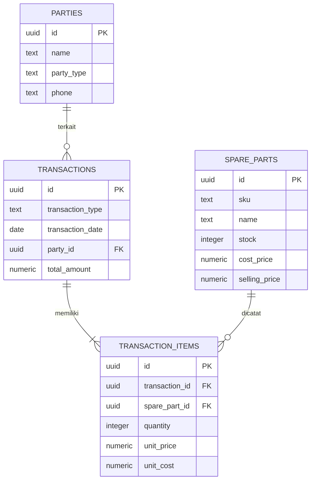

# RodaKas — Sistem Akuntansi Sparepart Motor

Aplikasi sederhana untuk mencatat persediaan, pembelian, penjualan, dan estimasi laba kotor. ERD terdiri dari empat entitas: `parties`, `spare_parts`, `transactions`, dan `transaction_items`.

## Menjalankan aplikasi

1. Jalankan seluruh isi [`backend/schema.sql`](backend/schema.sql) melalui SQL Editor Supabase.
2. Buka [`frontend/index.html`](frontend/index.html) langsung di browser.
3. Pada dialog koneksi, masukkan Project URL dan anon/public/publishable key dari Supabase → Project Settings → API. Pengaturan disimpan di browser ini; **jangan pernah memakai service-role key**.
4. Tekan **Simpan & hubungkan**. Jika browser memblokir permintaan dari `file://`, buka aplikasi melalui GitHub Pages.

## Mempublikasikan aplikasi untuk penilaian

Aplikasi hanya memerlukan GitHub Pages dan project Supabase yang sudah ada—tidak perlu Render atau hosting backend tambahan. Frontend memakai anon/publishable key dengan izin database terbatas serta fungsi SQL untuk menjaga stok transaksi secara atomik.

1. Jalankan seluruh [`backend/schema.sql`](backend/schema.sql) melalui SQL Editor Supabase.
2. Di repository GitHub, buka **Settings → Secrets and variables → Actions → Variables** dan tambahkan:
   - `SUPABASE_URL`: Project URL Supabase (`https://…supabase.co`).
   - `SUPABASE_ANON_KEY`: anon/public/publishable key dari Supabase API settings.
3. Di **Settings → Pages**, pilih **GitHub Actions** sebagai sumber deployment.
4. Push perubahan ke GitHub atau jalankan workflow **Deploy frontend to GitHub Pages** di tab **Actions**. Bagikan URL Pages setelah workflow berhasil.

**Akses publik:** peran `anon` dapat melihat data, mengelola kontak dan sparepart, serta membuat/mengedit/menghapus transaksi melalui fungsi yang divalidasi database. Tanpa login, siapa pun yang memiliki URL aplikasi dapat mengubah data. Gunakan project Supabase demo dan hindari data sensitif. Anon/publishable key boleh terlihat browser, tetapi **jangan pernah memasukkan `SUPABASE_SERVICE_ROLE_KEY` ke GitHub atau frontend**.

Pembelian menambah stok dan memperbarui harga pokok rata-rata tertimbang. Penjualan memeriksa stok, menguranginya, serta menyimpan harga pokok saat transaksi untuk perhitungan estimasi laba kotor. Tambahkan pemasok dan sparepart, lalu catat pembelian sebelum mencatat penjualan. Setiap transaksi dapat berisi lebih dari satu barang.

Menu **Laporan** menyediakan ringkasan penjualan, pembelian, dan estimasi laba kotor berdasarkan rentang tanggal, serta ekspor rincian transaksi ke CSV.

Sparepart dan kontak dapat diedit atau dihapus dari tabel masing-masing. Penghapusan ditolak bila data sudah digunakan dalam transaksi, agar riwayat akuntansi tetap utuh.

Transaksi juga dapat diedit atau dihapus dari tabel riwayat. Perubahan transaksi menghitung ulang stok dan harga pokok secara atomik; bila penyesuaian akan membuat stok tidak mencukupi pada transaksi berikutnya, perubahan dibatalkan. Sebelum memperbarui aplikasi yang sudah berisi data, buat backup Supabase, hentikan server, kemudian jalankan seluruh file [`backend/schema.sql`](backend/schema.sql) di SQL Editor Supabase untuk memasang kolom dan fungsi migrasi terbaru. Jika migrasi melaporkan saldo awal tidak konsisten, hentikan proses dan periksa stok serta riwayat transaksi; jangan hapus data untuk mengatasi error.

Tidak memerlukan `package.json` atau file `env.example`. GitHub Pages menyajikan frontend statis dan frontend mengakses Supabase REST API dengan izin yang diatur oleh grants, RLS, dan fungsi SQL.
